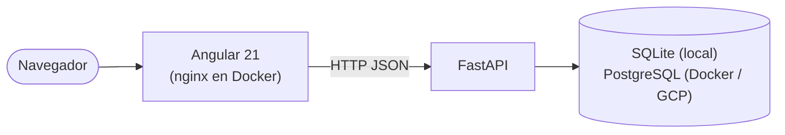
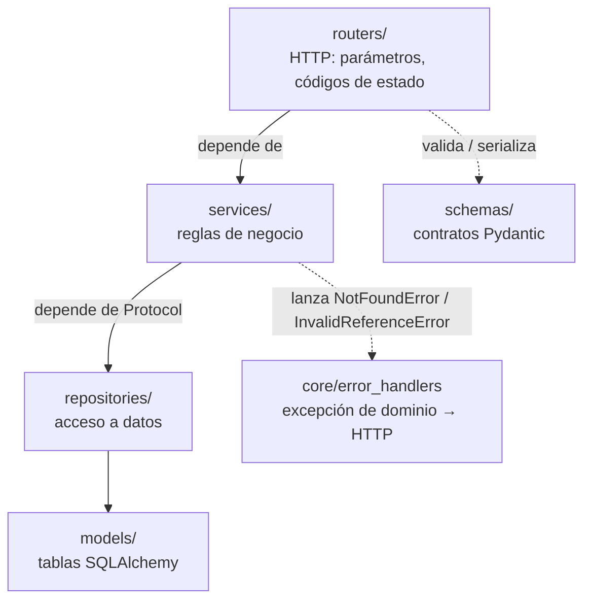
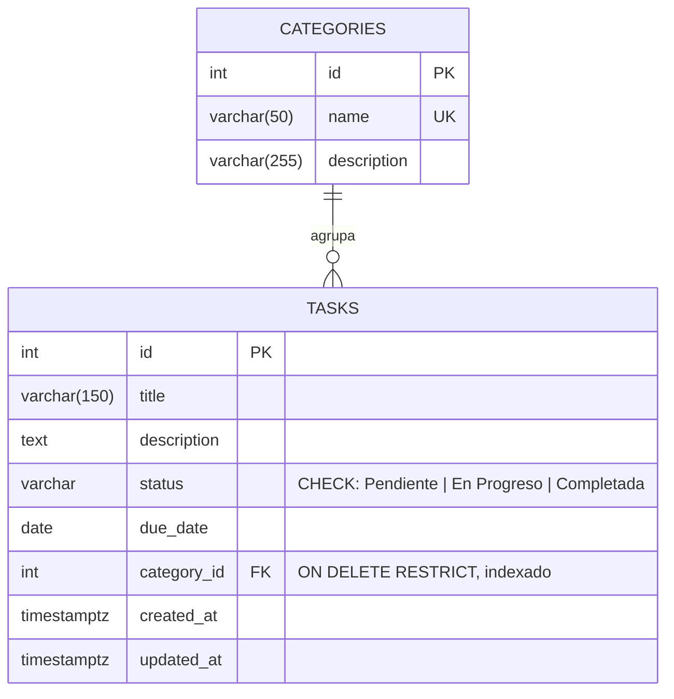
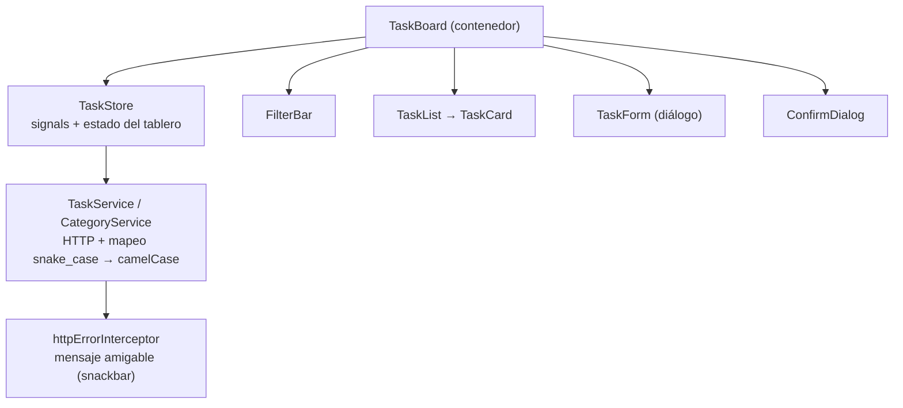

# Arquitectura

## Vista general

La base de datos se elige solo con `DATABASE_URL`: el código no cambia entre SQLite y PostgreSQL. En Docker, nginx sirve el frontend y reenvía `/api/*` al backend, así el navegador ve un único origen.

## Backend: capas

| Capa | Responsabilidad | No hace |
|---|---|---|
| `routers/` | Declarar endpoints, validar query params, devolver 201/204 | Lógica de negocio ni SQL |
| `services/` | Reglas: la categoría debe existir, la tarea debe existir, actualización parcial | Conocer HTTP: lanza excepciones de dominio, no `HTTPException` |
| `repositories/` | Consultas (filtros, paginación, `joinedload` para evitar N+1) | Decidir reglas |
| `models/` | Tablas, relaciones y restricciones (FK, `CHECK` del estado) | — |
| `schemas/` | Entrada y salida de la API (`TaskCreate`, `TaskUpdate`, `TaskRead`, `Page[T]`) | — |
| `core/` | Configuración (`pydantic-settings`), excepciones y su traducción a HTTP | — |

Los servicios dependen de **protocolos** (`repositories/protocols.py`), no de las clases concretas. Por eso `tests/test_task_service.py` prueba las reglas con repositorios en memoria, sin base de datos.

### Errores

| Situación | Origen | Respuesta |
|---|---|---|
| Tarea inexistente | `NotFoundError` en el servicio | `404 {"detail": "Tarea no encontrada"}` |
| Categoría inexistente al crear/editar | `InvalidReferenceError` | `422 {"detail": "Categoría no encontrada"}` |
| Estado, título o fecha inválidos | Validación de Pydantic | `422` con el detalle por campo |
| Cualquier excepción no prevista | Handler genérico | `500 {"detail": "Error interno del servidor"}`, sin stack trace |

La categoría inexistente responde `422` y no `404` porque la URL (`/tasks`) sí existe: lo inválido es un dato del cuerpo.

## Modelo de datos

- El estado se guarda como `VARCHAR` con `CHECK` (`Enum(native_enum=False, create_constraint=True)`): funciona igual en SQLite y PostgreSQL, y la base rechaza valores inválidos aunque alguien salte la API.
- `ON DELETE RESTRICT` impide borrar una categoría con tareas.
- El esquema lo crea Alembic (`alembic/versions/…0001…`); `tests/test_migrations.py` verifica que la migración coincida con los modelos.

## Frontend

- **Contenedor y presentacionales**: solo `TaskBoard` conoce el estado y los servicios. `FilterBar`, `TaskList`, `TaskCard` y `TaskForm` reciben `input()`s y emiten `output()`s, así se prueban sin HTTP.
- **`TaskStore`** se provee a nivel del componente: el estado vive mientras vive el tablero. Usa `switchMap` para descartar respuestas viejas al cambiar de filtro, y el cambio de estado es **optimista** (se ve al instante y se revierte si la API falla).
- **Edición**: se envía solo lo que cambió (`getTaskChanges`). Así una tarea vencida puede editarse sin reenviar su fecha, que la API rechazaría por estar en el pasado.
- **Errores**: el interceptor traduce cualquier error HTTP a un mensaje en español; el tablero además muestra un estado "No se pudieron cargar las tareas" con botón de reintento.
- **Fechas**: la API usa `YYYY-MM-DD` sin zona horaria. `parseIsoDate` la interpreta en hora local (con `new Date('YYYY-MM-DD')` Lima mostraría el día anterior) y `DayFirstDateAdapter` acepta `dd/mm/aaaa` al escribir.
- La ruta de tareas es **lazy** (`loadChildren`) y registra ahí sus providers de fecha y de i18n, fuera del bundle inicial.
