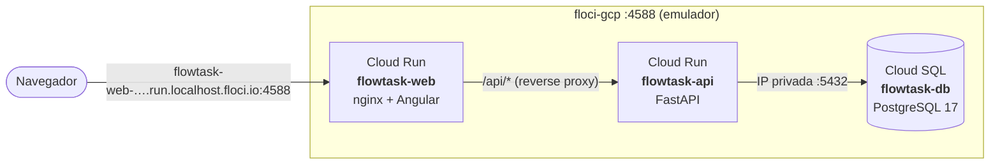

# Despliegue emulado en Google Cloud

FlowTask se despliega sobre **Cloud Run** y **Cloud SQL** usando [floci-gcp](https://github.com/floci-io/floci-gcp), un emulador local de Google Cloud que crea contenedores reales detrás de las APIs de GCP. Sirve para validar la arquitectura de despliegue sin cuenta de Google Cloud ni costos.

## Arquitectura



Son **las mismas imágenes** que usa `docker compose`: no hay builds específicos para GCP. La configuración llega por variables de entorno al iniciar cada servicio:

| Servicio | Variable | Valor |
|---|---|---|
| `flowtask-api` | `DATABASE_URL` | IP privada de la instancia de Cloud SQL |
| `flowtask-api` | `PORT` | Inyectada por Cloud Run (`8080`); el contenedor la respeta |
| `flowtask-web` | `API_UPSTREAM` | URL de invocación del servicio `flowtask-api` |

Al arrancar, el contenedor de la API aplica las migraciones de Alembic y el seed sobre Cloud SQL.

## Pasos

Requisitos: Docker Desktop en ejecución y Python 3.10+ (el script solo usa la biblioteca estándar).

```bash
# 1. Construir las imágenes (desde la raíz del repositorio)
docker compose build

# 2. Levantar el emulador de GCP
docker compose -f deploy/gcp/docker-compose.yml up -d

# 3. Desplegar Cloud SQL + los dos servicios de Cloud Run
python deploy/gcp/deploy.py
```

Al terminar, el script muestra las URLs:

```text
Despliegue completado:
  Web (Cloud Run)  http://flowtask-web-4c45b5764459.us-central1.run.localhost.floci.io:4588
  API (Cloud Run)  http://flowtask-api-4c45b5764459.us-central1.run.localhost.floci.io:4588/docs
  Cloud SQL        flowtask-local:us-central1:flowtask-db (172.22.0.3)
```

El dominio `*.localhost.floci.io` resuelve a `127.0.0.1`, así que las URLs se abren directamente en el navegador. El script es idempotente: al volver a ejecutarlo se redespliegan los servicios con las imágenes actuales.

Para validar el despliegue con la colección Bruno:

```bash
cd bruno && npx @usebruno/cli run --env floci-gcp
```

Para eliminar los recursos y apagar el emulador:

```bash
python deploy/gcp/deploy.py --destroy
docker compose -f deploy/gcp/docker-compose.yml down
```

## Equivalencia con Google Cloud real

| Emulado | En GCP real |
|---|---|
| Imágenes locales (`flowtask-backend:latest`) | Imágenes en **Artifact Registry** |
| Usuario `postgres`/`postgres` fijo del emulador | Credenciales en **Secret Manager** inyectadas como secretos |
| Conexión por IP privada de la red Docker | Conexión por IP privada (VPC) o **Cloud SQL Auth Proxy** |
| `API_UPSTREAM` hacia la ruta de invocación de floci | `API_UPSTREAM=https://flowtask-api-xxxx.run.app` |
| `python deploy/gcp/deploy.py` | `gcloud run deploy` / Terraform en un pipeline de CD |

## Limitaciones del emulador encontradas

- **Sin `gcloud` para Cloud Run**: floci solo expone la API REST v2, por eso el despliegue se hace con un script que llama a esa API.
- **Red conectada después del arranque**: floci crea los contenedores de Cloud Run en la red `bridge` y los conecta a la red del emulador una vez iniciados. nginx calcula su DNS al arrancar, así que el despliegue fija `NGINX_RESOLVER=127.0.0.11` (DNS embebido de Docker) en el servicio web. En Cloud Run real la red existe desde el inicio y no hace falta.
- **DNS embebido no propagado**: los contenedores de Cloud Run no reciben el DNS embebido de floci, así que la URL `*.localhost.floci.io` de un servicio no se resuelve desde otro servicio. Por eso la web invoca a la API por la ruta `/run/v2/projects/…/services/flowtask-api` del emulador, que también está documentada.
